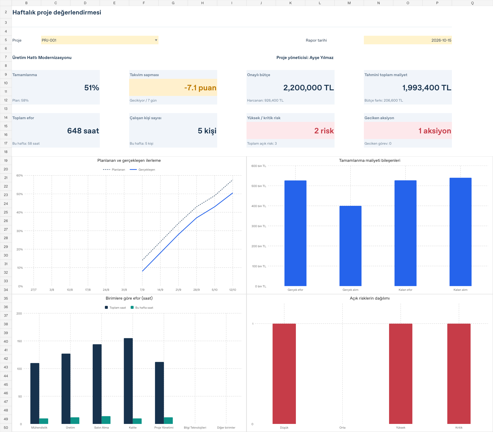
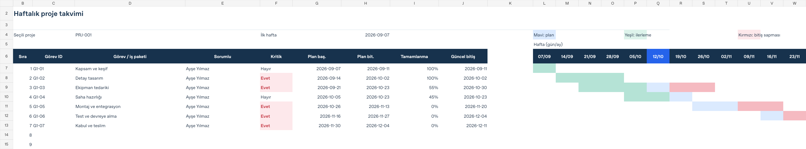
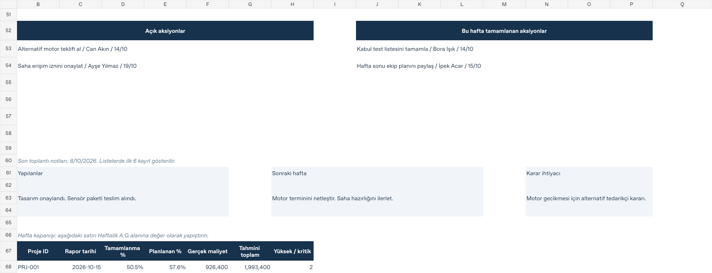

# İnteraktif Proje Takvimi

Haftalık proje toplantıları için hazırlanmış, veri girişleriyle grafikleri güncellenen makrosuz Excel şablonu. Dosyada üç kurgusal örnek proje bulunur.

## Excel dosyasını indirin

**[Proje_Takvimi.xlsx dosyasını indirin](./Proje_Takvimi.xlsx?raw=true)**

iPhone’da bu sayfayı Safari ile açabilirsiniz. Dosya indikten sonra **Dosyalar → İndirilenler → Paylaş → Excel** yolunu kullanın. Grafik ve formül uyumluluğu için Microsoft Excel önerilir.

## Panel önizlemesi

## İçerik

- **Panel:** Proje ve rapor tarihi seçimi, tamamlanma oranı, takvim sapması, bütçe, tahmini toplam maliyet, efor ve risk göstergeleri. Dört yerel Excel grafiği kaynak verilerden beslenir.
- **Portfoy:** Tüm projelerin ilerleme, efor, maliyet, bütçe ve risk karşılaştırması.
- **Takvim:** Seçili projenin haftalık Gantt görünümü. Planlanan işler, ilerleme ve tahmini bitiş sapmaları ayrı renklerde gösterilir.
- **Projeler:** Proje tanımları, onaylı tarihler, bütçe ve kalan efor tahmini.
- **Gorevler:** İş paketleri, sorumlular, birimler, ağırlıklar, ilerleme yüzdeleri ve güncel bitiş tarihleri.
- **Efor:** Kişi ve tarih bazında çalışma saatleri, birimler ve saat maliyetleri.
- **Maliyetler:** Gerçekleşen alımlar ile kalan malzeme, hizmet ve diğer alım tahminleri.
- **Riskler:** Olasılık, etki, risk seviyesi, risk sahibi ve azaltıcı önlemler.
- **Aksiyonlar:** Yapılacaklar, tamamlanan işler, kararlar, sorumlular ve hedef tarihler.
- **Haftalik:** Haftalık sonuçlar ve toplantı notlarının arşivi.
- **Kullanim:** Veri girişi, hesaplama yöntemleri ve haftalık çalışma adımları.

## Nasıl kullanılır?

1. Excel dosyasında **Kullanim** sayfasını okuyun.
2. Sarı veri giriş alanlarını kendi proje bilgilerinizle değiştirin. Proje ID ve Personel ID alanlarını tutarlı kullanın.
3. **Panel!C5** alanından projeyi, **Panel!N5** alanından rapor tarihini seçin.
4. Haftalık sunum öncesinde görev ilerlemelerini, güncel bitişleri, kalan tahminleri, riskleri ve aksiyonları güncelleyin.
5. Hafta kapanışında **Panel!B68:H68** satırını kopyalayıp **Haftalik** sayfasındaki yeni satırın **A:G** alanına **Özel Yapıştır → Değerler** ile yapıştırın. **H:K** alanlarına toplantı notlarını girin. Her proje ve hafta için tek arşiv satırı tutun.

## Hesaplama kuralları

- **Tamamlanma:** Görev ağırlıklarıyla hesaplanan ortalama. Ağırlıkların toplamı 100 olmak zorunda değildir.
- **Planlanan ilerleme:** Planlanan başlangıç ve bitiş arasında takvim günlerine göre doğrusal ilerleme varsayımı. Hafta sonları ve tatiller ayrıca çıkarılmaz.
- **Takvim sapması:** Gerçekleşen yüzde eksi planlanan yüzde, yüzde puan olarak gösterilir.
- **Kişi sayısı:** Proje ve dönem içinde benzersiz Personel ID sayısı. Aynı kişinin tekrarlanan efor satırları kişi sayısını artırmaz.
- **Efor maliyeti:** Kaydedilen saat × o satırın saat maliyeti.
- **Tahmini toplam maliyet:** Gerçekleşen efor + gerçekleşen alımlar + kalan efor tahmini + kalan alım tahmini.
- **Bütçe farkı:** Onaylı bütçe − tahmini toplam maliyet. Negatif değer bütçe aşımıdır.
- **Risk puanı:** Olasılık × etki. 1–4 düşük, 5–9 orta, 10–15 yüksek, 16–25 kritik.
- Tüm parasal tutarlar **TL ve KDV hariçtir**.

Rapor tarihi, efor ve gerçekleşen alımlarda toplama kesimidir. Görev ilerlemeleri, kalan maliyet tahminleri ve risk/aksiyon durumları güncel fotoğraftır. Tarihi geri almak eski durumları geri getirmez; geçmiş sonuçlar **Haftalik** arşivinden incelenir. Haftalık arşiv otomatik oluşturulmaz.

## Gantt önizlemesi

Kritik işaretleri proje yöneticisi tarafından girilir. Öncül görev ID bilgi amaçlıdır; dosya otomatik kritik yol veya bağımlılığa göre tarih öteleme hesabı yapmaz. Yeşil bant, ilerleme yüzdesinin plan süresine dağıtılmış görsel karşılığıdır.

## Aksiyonlar ve toplantı notları

## Hazır kapasite

20 proje, 200 görev, 600 efor kaydı, 200 alım, 120 risk, 200 aksiyon ve 260 haftalık kayıt için hazır alan vardır. Kapasiteyi aşarken formül, doğrulama ve özet aralıkları da genişletilmelidir.

Takvim ilk 40 görevi ve 26 haftayı, panel aksiyon listeleri ilk 6 kaydı, ilerleme grafiği son 12 haftayı gösterir. Kayıtsız haftalar çizilmez; grafik veri alanındaki `#N/A` değerleri bu amaçla kullanılır.

## Doğrulama

Ağırlıklı ilerleme, benzersiz kişi sayısı, maliyetler, eksik ve sıfır girdiler, rapor tarihi kesimi ve risk değişimleri kontrol edildi. Başlangıç ve değiştirilmiş veri senaryoları LibreOffice ile ayrıca yeniden hesaplandı; grafik veri bağları ve güncellenen grafik önbelleği karşılaştırıldı. Microsoft Excel üzerinde ayrıca elle açılış kontrolü yapılmadı.

Önizlemeler sabit görsellerdir. İnteraktif hesaplamalar ve grafikler Excel dosyasındadır. Örnekler gerçek proje veya şirket bilgisi içermez.
