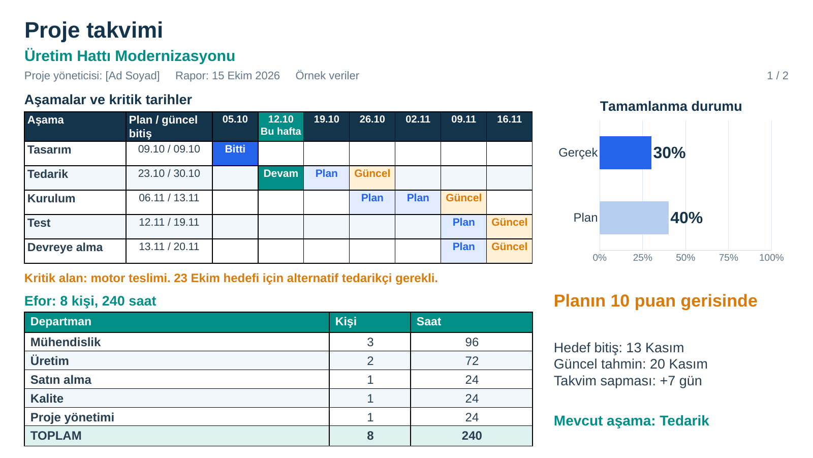
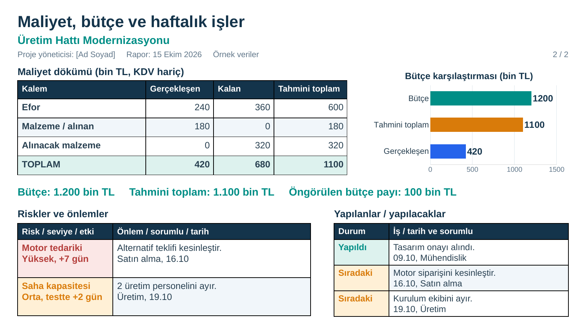

# Proje takvimi

Tek projenin haftalık yönetim sunumu için **iki sayfalık, düzenlenebilir PowerPoint**. Önceki çalışma [old/](./old/) klasöründe saklanır. Bu sürüm sıfırdan hazırlanmıştır.

- [PowerPoint’i indir](./Proje_Takvimi.pptx?raw=true)
- [PDF’yi telefondan görüntüle](./Proje_Takvimi.pdf?raw=true)

Proje adı, tarihler, departmanlar, bütçe ve riskler **örnek veridir**. Üretim tamamlanması önceki örnekte verilen **%30** ile başlar. Kendi projenize göre değiştirin.

## 1. sayfa: Takvim, ilerleme ve efor

- Haftalara bölünmüş aşamalar, mevcut aşama, planlanan ve güncel bitiş tarihleri.
- Kritik teslimat ve takvime etkisi.
- **Gerçek %30 / plan %40** karşılaştırma grafiği. Örnek proje planın 10 yüzde puanı gerisindedir; bitiş tahmini 7 gün gecikmiştir.
- Departmanlara göre kişi ve rapor tarihine kadar toplam çalışma saati.

## 2. sayfa: Maliyet, bütçe, risk ve işler

- Efor, alınan malzeme ve alınacak malzeme için gerçekleşen, kalan ve tahmini toplam maliyet.
- Bütçe ve tahmini maliyet karşılaştırma grafiği.
- Risk seviyesi, beklenen etkisi, önlemi, sorumlusu ve aksiyon tarihi.
- Yapılan işler ve sıradaki işler; sorumluları ve tarihleri.

## Haftalık kullanım

1. Proje adını, yöneticiyi ve rapor tarihini değiştirin. Aşama tarihlerini ve takvimdeki çalışma haftalarını güncelleyin. Başlıklardaki tarihler hafta başlangıçlarıdır. **Plan** baz takvimi, **Güncel** revize takvimi, **Devam** mevcut aşamayı gösterir.
2. Tamamlanma grafiğine sağ tıklayıp **Verileri Düzenle** seçeneğini açın. **Plan** ve **Gerçek** satırlarına yüzde işareti olmadan `0–100` arasında sayı yazın. Örneğin `30` değerini `45` yaptığınızda grafik **%45**, `20` yaptığınızda **%20** gösterir. Grafik verisi dosyanın içindeki gömülü Excel tablosundadır; ayrı dosya gerekmez.
3. Kişi ve saatleri departman bazında girin. Örnekte departmanların kişi sayıları farklı çalışanları temsil eder. Aynı kişiyi birden fazla departmanda saymayın.
4. Maliyetleri **bin TL, KDV hariç** girin. Efor için gerçekleşen ve kalan tutarı ayırın. Alınmış malzemeleri ve henüz alınacakları ayrı satırlarda tutun. Tahmini toplam, gerçekleşen ve kalan maliyetlerin toplamıdır. **Öngörülen bütçe payı = bütçe − tahmini toplam maliyet**; negatif değer beklenen bütçe aşımıdır.
5. Bütçe grafiğinin **Verileri Düzenle** tablosuna gerçekleşen maliyeti, tahmini toplamı ve bütçeyi girin. Riskleri ve haftalık işleri güncelleyin; yeni haftanın kopyasını tarih vererek saklayın.

**Grafikler resim değildir ve kendi veri tablolarıyla güncellenir.** Normal PowerPoint tabloları, toplam satırları, plan farkı ve bitiş özeti ise ayrıca düzenlenir; grafikle otomatik bağlantıları yoktur. Örneğin gerçek ilerlemeyi değiştirdiğinizde “planın 10 puan gerisinde” metnini de yeniden hesaplayıp değiştirin. PDF ve PNG önizlemeleri sabittir; veri girişinden sonra PowerPoint’ten yeniden PDF kaydedin.

**iPhone:** Hızlı görüntüleme için PDF bağlantısını kullanın. PowerPoint indirme bağlantısını Safari’de açıp dosyayı Dosyalar uygulamasına kaydedebilirsiniz. Grafik veri girişini masaüstü PowerPoint’te yapın; mobil sürümlerde düzenleme seçenekleri sınırlı olabilir.
