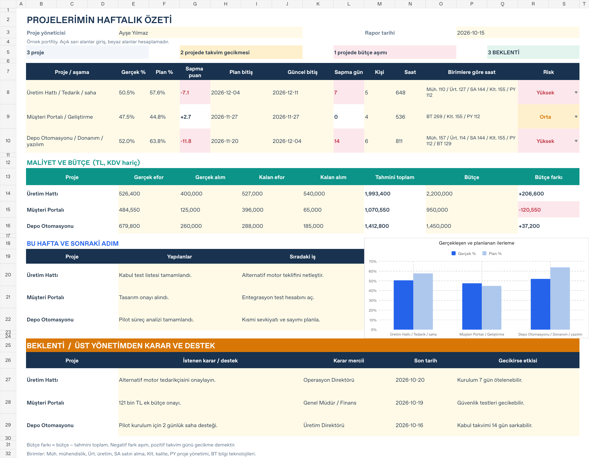

# Proje yöneticisinin haftalık özeti

Tek proje yöneticisinin projelerini üst yönetime aktaracağı renkli ve sade şablon. Üç kurgusal örnek proje içerir.

| Dosya | İçerik | İndir |
| --- | --- | --- |
| Excel | **Tek sekme ve tek yazdırma sayfası.** Veri girişleri, otomatik hesaplamalar ve güncellenen grafik. | [Excel’i indir](./Proje_Takvimi.xlsx?raw=true) |
| PowerPoint | **2 düzenlenebilir slayt.** Proje özeti, haftalık işler ve BEKLENTİ. | [PowerPoint’i indir](./Proje_Sunumu.pptx?raw=true) |
| PDF | **2 sayfa.** PowerPoint’in telefondan görüntülenebilen sürümü. | [PDF’yi aç](./Proje_Sunumu.pdf?raw=true) |

## Ekranda neler var?

- **Proje durumu:** Güncel aşama, gerçek ve planlanan ilerleme, bitiş tarihleri, gecikme ve risk seviyesi.
- **Efor ve maliyet:** Kişi sayısı, toplam saat, birimlere göre saat, gerçekleşen ve kalan maliyet, bütçe ve bütçe farkı.
- **Haftalık işler:** Yapılanlar ve sıradaki iş.
- **BEKLENTİ:** Üst yönetimden istenen karar veya destek, karar mercii, son tarih ve gecikirse etkisi.

## Excel önizlemesi

## Kullanım

1. Proje yöneticisini, rapor tarihini ve **açık sarı giriş alanlarını** güncelleyin. Her satır bir projedir. Planlanan yüzde, kişi/saat, birim dağılımı ve maliyet özetlerini yönetici girer.
2. Yüzde ve gün sapması, tahmini toplam maliyet, bütçe farkı ve özet göstergeleri otomatik hesaplanır. Grafik, ilerleme yüzdeleriyle güncellenir. Beyaz hesaplama alanlarını koruyun.
3. **BEKLENTİ** alanına genel bir açıklama yerine istenen karar veya desteği, kimden istendiğini ve tarihini yazın.
4. Haftalık geçmiş için dosyanın bir kopyasını rapor tarihiyle saklayın. Bu sade sürümde ayrı arşiv ve veri sekmeleri yoktur.

Excel tutarları **TL ve KDV hariç**, sunumdaki maliyet tablosu **bin TL ve KDV hariçtir**. Bütçe farkı bütçe eksi tahmini toplamdır. Negatif fark aşım, pozitif takvim günü gecikme demektir. Kalan maliyet yoksa **0** girin; boş bırakılan maliyet eksik bilgi olarak gösterilir.

Excel, A3 yatayda tek sayfaya yazdırılacak şekilde ayarlanmıştır. PowerPoint tabloları düzenlenebilir; Excel ile otomatik veri bağlantısı yoktur. PowerPoint ve PDF, bu raporun hazırlanma anındaki örnek değerlerini içerir.

**iPhone:** Bu sayfayı Safari’de açıp indirme bağlantısını kullanın. İnen dosyayı **Dosyalar → İndirilenler → Paylaş → Excel / PowerPoint** yoluyla açabilirsiniz. Hızlı görüntüleme için PDF bağlantısını kullanın.

[Sunum 1. sayfa önizlemesi](./onizleme/sunum-1.png) · [Sunum 2. sayfa önizlemesi](./onizleme/sunum-2.png)
